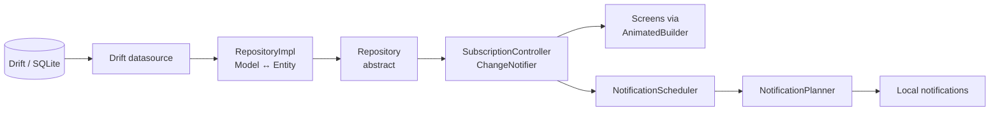

# One Spend

**A subscription and spend tracker for Android, styled after Samsung One UI 8.5.**

One Spend keeps track of your recurring payments: what you pay, when it renews, which card it's charged to, and how it adds up against your monthly budget. It works entirely offline on a pitch-black OLED theme with reachable floating controls.


---

## Table of contents

- [Features](#features)
- [Tech stack](#tech-stack)
- [Getting started](#getting-started)
- [Development](#development)
- [Project structure](#project-structure)
- [Architecture](#architecture)
- [Database and migrations](#database-and-migrations)
- [Testing](#testing)
- [Design language](#design-language)
- [Website](#website)
- [Contributing](#contributing)
- [Privacy](#privacy)
- [Known limitations](#known-limitations)

---

## Features

### Subscriptions
- Add subscriptions from a catalog of popular services with bundled brand logos, or build your own with a custom icon.
- Categories, flexible billing cycles, start dates and linked payment methods.
- Customize each subscription's card and detail page.
- Search, sort and filter the list.
- Multi-select mode: duplicate, move to a category, or export the selection as CSV.

### Upcoming
- Timeline and calendar views of upcoming renewals.
- Groups for overdue, due this week, due this month and later.
- Mark a charge as paid (with confirmation) and browse recorded payment history.
- Long-press selection mode for bulk actions.

### Analytics
- Spending by category, billing-cycle commitments and forecasts.
- Annual-plan savings, top single expense and smart insights.

### Budget
- Monthly budget threshold with a budget card and over-budget alerts.

### Payment methods
- Manage cards and other payment methods with brand icons and expiry dates.
- See which subscriptions each card pays for.

### Notifications
- Local reminders for upcoming renewals, expiring cards and budget overruns.
- Reminder days and time can be set per subscription, or follow a global default.
- Tapping a notification deep-links to the relevant screen.

### Data
- Everything is stored on-device in SQLite (Drift).
- Save a backup file (JSON) and restore it on any phone, either adding what's missing or replacing everything.
- Automatic restore points before data is replaced or cleared, listed under Backup & data › Restore points.
- Export a PDF report, CSV or text summary, or renewals to a calendar (`.ics`). Exports are for reading and can't be restored.
- Restore the sample catalog, or clear all data.
- Check for updates from Google Play (Settings › About), with a quiet check on launch.

### Appearance
- Card studio: price format, cycle progress bar and metadata chips.
- Detail page styling: icon visibility, icon shape and highlight colour.
- Toggles for 3D depth on the nav bar, floating pills and cards, plus a bottom vignette.

---

## Tech stack

| Concern | Package |
|---|---|
| UI framework | [Flutter](https://flutter.dev) (Dart `^3.13.3`) |
| Navigation | [`go_router`](https://pub.dev/packages/go_router): `StatefulShellRoute` with 4 tabs |
| Persistence | [`drift`](https://pub.dev/packages/drift), `drift_flutter`, `sqlite3_flutter_libs` |
| Dependency injection | [`get_it`](https://pub.dev/packages/get_it) |
| State | `ChangeNotifier` singletons plus `AnimatedBuilder` |
| Notifications | [`flutter_local_notifications`](https://pub.dev/packages/flutter_local_notifications), `timezone`, `flutter_timezone` |
| Sharing and links | `share_plus`, `url_launcher` |
| Assets | `flutter_svg` |
| Formatting | `intl` |
| Legacy migration | `shared_preferences` (one-time import into Drift) |
| Codegen | `build_runner`, `drift_dev` |
| Linting | `flutter_lints` |

---

## Getting started

### Prerequisites

- Flutter SDK with Dart **3.13.3 or newer** (`flutter --version`).
- Android SDK and either an emulator or a device with USB debugging enabled.
- A JDK compatible with your Android Gradle Plugin. Android Studio's bundled JBR works.

Check your setup with:

```bash
flutter doctor
```

### Run the app

```bash
git clone https://github.com/syedarhamraza/one-spend.git
cd one-spend
flutter pub get
flutter run
```

A fresh install starts empty. To load the demo catalog, go to **Settings → Restore sample subscriptions**.

### Releasing

The version lives in **one place**, `pubspec.yaml`:

```yaml
version: 1.0.0-alpha.1+1   # MAJOR.MINOR.PATCH[-alpha.N|-beta.N]+CODE
```

- **Name** (before `+`) is what users see in Settings › About.
  - `MAJOR`: big redesigns or breaking changes.
  - `MINOR`: new features.
  - `PATCH`: fixes only.
  - `-alpha.N` and `-beta.N` mark pre-releases.
- **Code** (after `+`) is the Android `versionCode`. It goes up by one for **every** upload to Google Play and is never reused.

| Suffix | Play Console track |
|---|---|
| `-alpha.N` | Internal or Closed testing |
| `-beta.N` | Open testing |
| none | Production |

Don't edit the version by hand. When you're ready to upload, run one command from a clean tree:

| You want to… | Command | Version change |
|---|---|---|
| Start a feature version in beta | `./tool/release.ps1 -Bump minor -Pre beta` | `1.0.0` → `1.1.0-beta.1` |
| Ship the next beta | `./tool/release.ps1 -Pre beta` | `1.1.0-beta.1` → `1.1.0-beta.2` |
| Release it | `./tool/release.ps1 -Promote` | `1.1.0-beta.2` → `1.1.0` |
| Ship a bug fix | `./tool/release.ps1 -Bump patch` | `1.1.0` → `1.1.1` |
| Re-upload the same version | `./tool/release.ps1 -Rebuild` | build number only |

Every one of these also raises the build number.

The script:
1. runs `flutter analyze` and `flutter test`, and stops before changing anything if either fails;
2. bumps `pubspec.yaml`;
3. adds a What's new entry to `lib/core/config/changelog.dart`, then pauses so you can write the notes;
4. builds `build/app/outputs/bundle/release/app-release.aab`;
5. commits `chore(release): …` and tags `v<name>`.

Then upload the bundle and run `git push --follow-tags`. `./tool/release.ps1 -Help` lists everything. `./tool/release.ps1 -Debug` builds a debug APK of the current version without changing it.

**Upload key (one-time setup).** Play only accepts bundles signed with your upload key.

1. Create the keystore, and keep it and its passwords somewhere safe outside the repo:

   ```bash
   keytool -genkey -v -keystore C:/Users/<you>/keys/onespend-upload.jks -keyalg RSA -keysize 2048 -validity 10000 -alias upload
   ```

2. Create `android/key.properties`. It's ignored by git.

   ```properties
   storeFile=C:/Users/<you>/keys/onespend-upload.jks
   storePassword=…
   keyAlias=upload
   keyPassword=…
   ```

Without `key.properties`, release builds are signed with the debug key. `flutter build` allows that for local testing, but the release script stops instead (unless you pass `-SkipBuild`).

The application id is `com.syedarhamraza.onespend`. It can't change once the app is on Google Play.

---

### Crash reports and analytics

Firebase project **`one-spend`** is connected through `android/app/google-services.json`. That file is committed: it identifies the project and holds no secrets. The Google Services and Crashlytics Gradle plugins are set up in `android/settings.gradle.kts` and `android/app/build.gradle.kts`. Without the file, the app starts normally and only logs to the console.

**What sends:**
- Release builds send crash reports and analytics.
- Debug builds don't, unless you run with `--dart-define=TELEMETRY_IN_DEBUG=true`.

**To check it works:**
1. Run:

   ```bash
   flutter run --dart-define=TELEMETRY_IN_DEBUG=true
   ```

2. Tap **Settings › Developer options › Send test error**. It appears in the Crashlytics console within a few minutes. Crash reports are sent the next time the app starts, so restart the app if one doesn't show up.
3. For live analytics, run this, then watch **Analytics › DebugView**:

   ```bash
   adb shell setprop debug.firebase.analytics.app com.syedarhamraza.onespend
   ```

**Play Console › App content › Data safety** (answers for this setup):

| Data type | Collected | Shared | Why |
|---|---|---|---|
| Crash logs | Yes | No | App functionality (crash fixing) |
| Diagnostics | Yes | No | App functionality, Analytics |
| App interactions | Yes | No | Analytics |
| Device or other IDs (Firebase installation ID) | Yes | No | Analytics |

The rest of the form:
- Data is encrypted in transit.
- Collection is required, with no opt-out.
- Users can't ask for deletion in the app: there's no account, and the data isn't linked to a person.
- Under **Advertising ID**, answer **No**: it's removed in the manifest.

Play also needs a **privacy policy URL**. Host `docs/privacy-policy.md`, for example with GitHub Pages.

## Development

| Task | Command |
|---|---|
| Install dependencies | `flutter pub get` |
| Static analysis | `flutter analyze` |
| Run all tests | `flutter test` |
| Run a single test file | `flutter test test/features/drift_migration_test.dart` |
| Run a single test by name | `flutter test --plain-name "save and load subscriptions"` |
| Regenerate Drift code | `dart run build_runner build --delete-conflicting-outputs` |

Regenerate Drift code whenever you change anything under `lib/core/database/tables/` or the `@DriftDatabase` annotation. The generated `app_database.g.dart` is checked in.

---

## Project structure

```text
lib/
├── main.dart                  # Entry point: configureDependencies() → runApp
├── core/
│   ├── database/              # Drift AppDatabase, tables, JSON converters, prefs migrator
│   ├── di/                    # GetIt service locator (injection.dart)
│   ├── error/
│   └── router/                # go_router config, AppRoutes, shell + page routes
├── features/                  # Feature-first clean architecture
│   ├── subscriptions/         # data / domain (BillingSchedule, SubscriptionStats) / presentation
│   ├── payment_methods/
│   ├── settings/
│   ├── appearance/            # OneUIEffectsController (card studio, 3D effects)
│   └── notifications/         # NotificationPlanner, NotificationScheduler, services
├── models/subscription.dart   # Backward-compat barrel + SubscriptionStore typedef
├── screens/                   # Screens (flat UI layer)
├── widgets/                   # OneUI* component library
├── theme/                     # OneUITheme tokens and dynamic getters
└── utils/
assets/logos/                  # Brand and payment-network logos (SVG/PNG)
docs/design-language.md        # UI source of truth
test/
├── features/                  # Domain, persistence, router and notification tests
├── widgets/                   # Widget tests for screens and components
└── helpers/test_app.dart      # routedTestApp() for tests that navigate
```

---

## Architecture

The data and domain layers follow **feature-first clean architecture**. Most UI still lives in the older flat `screens/` and `widgets/` layer.



### State

- **`SubscriptionController`** (exposed to screens as `SubscriptionStore.instance`) is the single app-wide store for subscriptions, payment methods and user settings. Computed values are memoized and invalidated whenever the controller notifies listeners.
- **Granular persistence.** Each mutation queues only the rows or keys it changed on a serial write queue. Repositories expose `upsert`, `delete` and `replaceAll`; nothing loads, modifies and saves. `pendingWrites` completes when the queue is empty.
- **`OneUIEffectsController`** stores appearance preferences as `app_settings` rows prefixed with `appearance.`.

### Startup

`configureDependencies()` in `lib/core/di/injection.dart` runs before `runApp`:

1. Registers `SharedPreferences` and `AppDatabase`.
2. Runs `SharedPreferencesMigrator`, a one-time import of legacy prefs into Drift. It is gated by the `drift_migrated_v1` and `appearance_migrated_v1` flags.
3. Registers datasources, repositories and controllers.
4. Awaits the controller's `load()` and the effects controller's `init()`.

### Navigation

- `createAppRouter()` builds a `StatefulShellRoute.indexedStack` with four tabs: **Subscriptions**, **Upcoming**, **Analytics** and **Settings**. `HomeScreen` is the shell and owns the floating nav bar.
- Full-screen pages are defined in `buildPageRoutes()`. Subscription pages are addressed by id (for example `AppRoutes.subscriptionDetail(id)`) and show a not-found fallback when the id no longer exists.
- Screens navigate through static helpers such as `CategoryPickerScreen.open(...)`, which wrap `context.push<T>`.

### Notifications

Notifications are local only; there is no push server.

- **`NotificationPlanner`** is pure logic. It turns the current data into a plan of renewal, card-expiry and over-budget alerts covering a rolling **60-day window**, capped at **50** notifications.
- **`NotificationScheduler`** re-plans (debounced) whenever the controller changes and whenever the app resumes. Each time, it cancels the previous plan before scheduling the new one.
- **Deep links:** each notification's payload is a go_router location, so tapping one opens the matching screen, including on cold start.

---

## Database and migrations

- Drift database at `lib/core/database/app_database.dart`, currently at **schema version 2**. Version 2 added the per-subscription `reminderTimeMinutes` column.
- Tables: subscriptions, payment methods, and a key/value `app_settings` table.
- List fields are stored as JSON through the type converters in `lib/core/database/converters/`.
- Settings keys keep their legacy `onespend_*` names so older installs still migrate correctly.

**To change the schema:**

1. Edit the table under `lib/core/database/tables/`.
2. Run `dart run build_runner build --delete-conflicting-outputs`.
3. Bump `schemaVersion` and add an `onUpgrade` step to the `MigrationStrategy`.
4. Add or extend a migration test (see `test/features/drift_migration_test.dart`).

---

## Testing

Any test that touches the controller or database must inject an in-memory database first:

```dart
setupDependencies(database: AppDatabase.forTesting(NativeDatabase.memory()));
SubscriptionStore.instance.resetForTesting(); // optional: seed demo data
```

- Passing `database:` re-registers the datasources, repositories and controller, so each test starts with fresh state.
- `setupDependencies()` registers `NoopNotificationService`, so tests never call the notifications plugin.
- **Reload tests:** `await controller.pendingWrites`, then build a second controller on the same database and `await load()` (see `test/features/persistence_regression_test.dart`).
- **Navigation tests:** any widget that calls `context.push` must be hosted with `routedTestApp(widget)` from `test/helpers/test_app.dart`, not `MaterialApp(home: ...)`.

---

## Design language

All UI follows [`docs/design-language.md`](docs/design-language.md), which covers the One UI 8.5 tokens, the component catalog and the interaction patterns. The key rules:

- Every screen sits on true black (`surfacePitch`), with content in soft, rounded charcoal cards.
- **Every option is a subpage** with a back button and a floating **Cancel | Save** pill.
- **No Material dialogs, date/time pickers or snackbars.** Use the `OneUI*` equivalents in `lib/widgets/`.
- Get card and floating colours, borders and shadows from `OneUITheme`'s dynamic getters, because users can turn 3D effects on and off.
- Every interaction triggers haptic feedback.

---

## Website

The landing page lives in its own public repo, [syedarhamraza/syedarhamraza.github.io](https://github.com/syedarhamraza/syedarhamraza.github.io), and is served at https://syedarhamraza.github.io. It uses copies of this repo's store captures (`tool/store_graphics/captures/`), the icon and feature graphic (`store/play/`) and `docs/privacy-policy.md`. After changing any of them, run `npm run sync -- ../one-spend` in the site repo and push.

---

## Contributing

1. Create a branch from `main` (`feat/<topic>` or `fix/<topic>`).
2. Use [Conventional Commits](https://www.conventionalcommits.org/) with a scope, for example `feat(upcoming): …` or `fix(detail): …`.
3. Before opening a pull request:
   - `flutter analyze` reports no issues.
   - `flutter test` passes, and new behaviour has tests.
   - Drift code is regenerated if tables changed, and `schemaVersion` is bumped with a migration.
   - UI changes follow the [design language](docs/design-language.md). Check layouts on a 360dp-wide screen and at large font sizes.
4. Open a pull request against `main` with a short description and screenshots for UI changes.

---

## Privacy

One Spend has no accounts, ads, network sync or push server. All data, including subscriptions, payment method details and settings, stays in the app's local SQLite database. For cards, only the last 4 digits are stored.

To fix bugs, release builds send **crash reports** (Firebase Crashlytics) and **anonymous usage statistics** (Firebase Analytics: screens viewed and features used) to Google Firebase. These never include subscription names, prices, notes, URLs or card details; events carry only fixed names, counts and on/off flags (see `lib/core/telemetry/events.dart`). The Advertising ID and ad attribution are switched off. Debug builds send nothing. Your own data leaves the device only when you choose to share an export or backup.

The privacy policy draft is in [`docs/privacy-policy.md`](docs/privacy-policy.md).

---

## Known limitations

- **Android only.** The repo has no iOS, web or desktop platform directories.
- **Dark theme only**, by design.
- The UI layer is partly migrated. Data and domain logic use feature folders, but most screens still live in `lib/screens/`.
