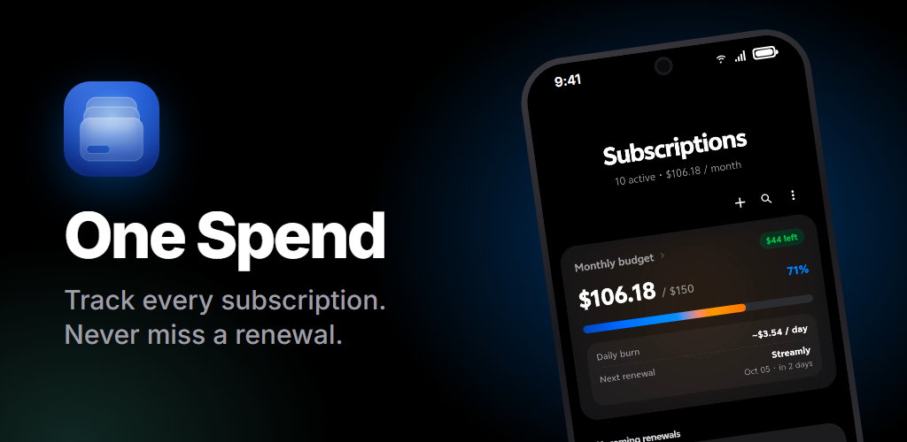
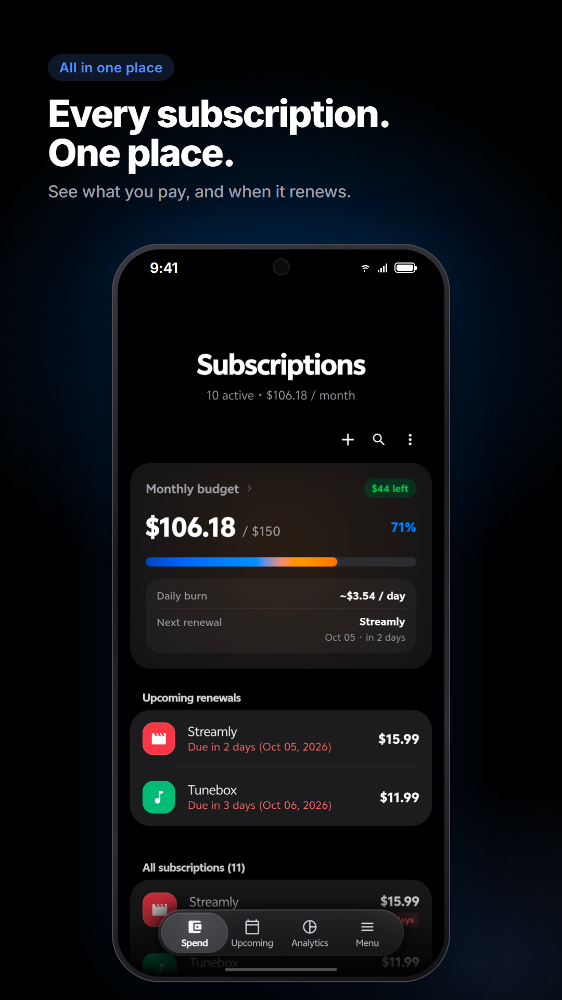
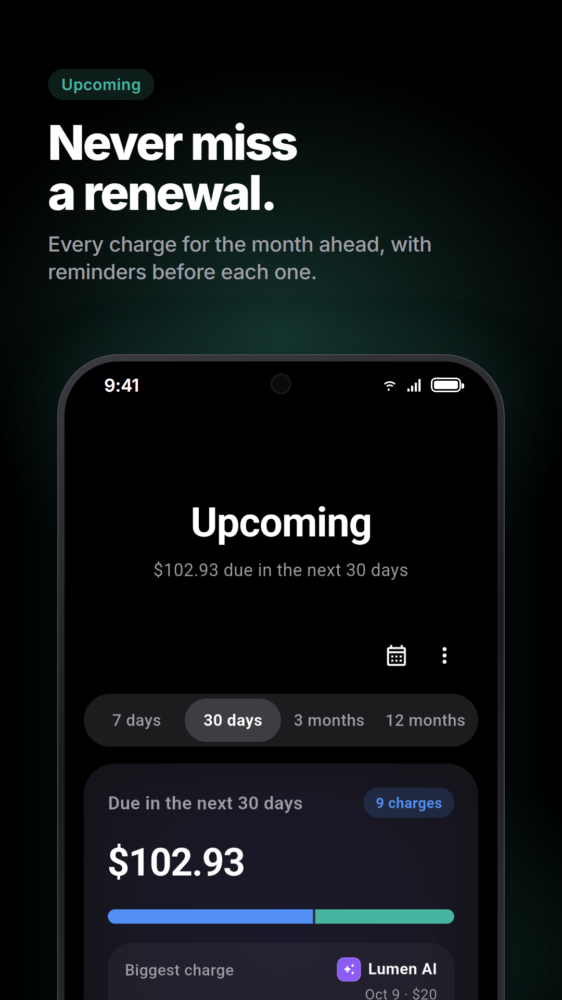
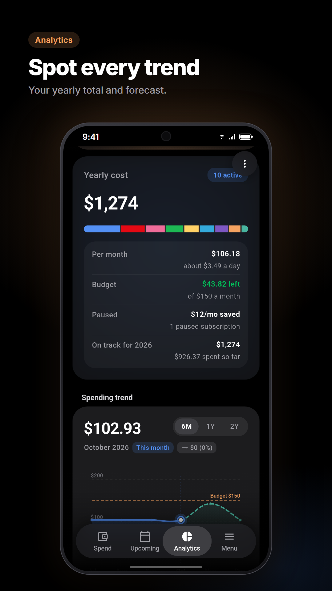
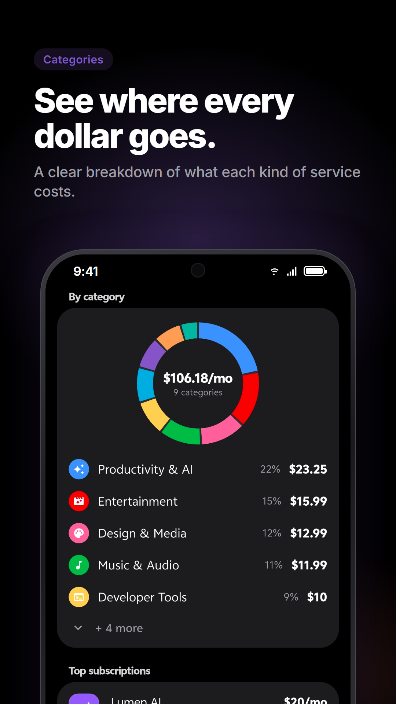
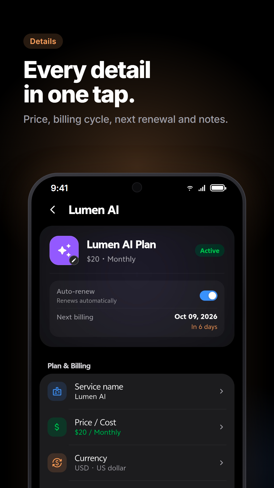
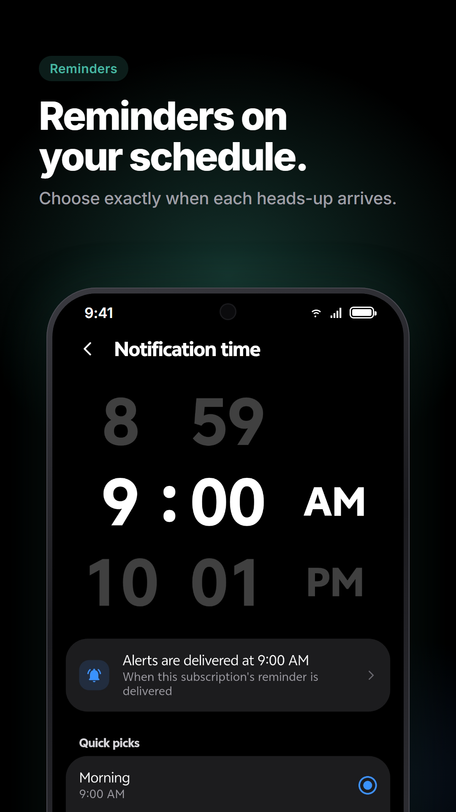
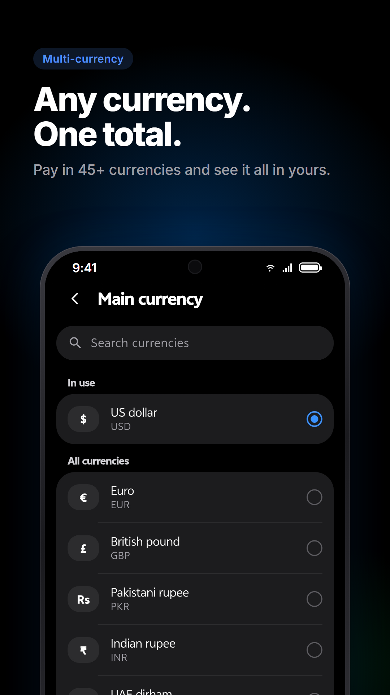
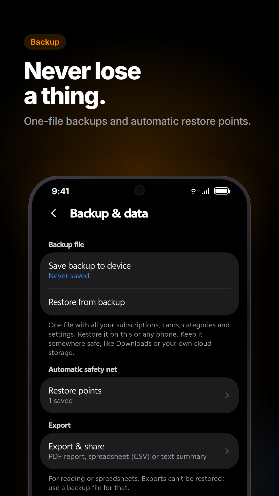
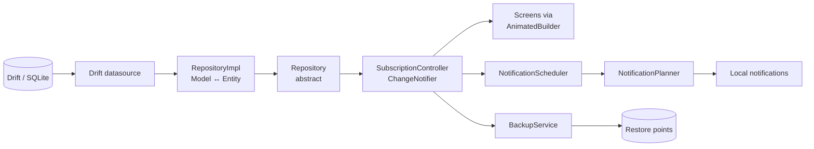

<div align="center">



# One Spend

**A subscription and spend tracker for Android, styled after Samsung One UI 8.5.**

Know what you pay, when it renews, which card it's charged to, and how it adds up against your budget. Offline-first, free, and with no accounts or ads.

[](https://github.com/syedarhamraza/one-spend/actions/workflows/ci.yml)


[**Get it on Google Play**](https://play.google.com/store/apps/details?id=com.syedarhamraza.onespend) · [Website](https://syedarhamraza.github.io) · [Privacy policy](docs/privacy-policy.md)

</div>

---

## Screenshots

<table>
  <tr>
    <td></td>
    <td></td>
    <td></td>
    <td></td>
  </tr>
  <tr>
    <td></td>
    <td></td>
    <td></td>
    <td></td>
  </tr>
</table>

## Highlights

- **Your data stays on your phone.** Everything lives in a local SQLite database. No sign-up, no cloud sync, no ads.
- **Never miss a renewal.** Local reminders per subscription, plus alerts for expiring cards and going over budget.
- **See where the money goes.** Monthly and yearly totals, category breakdowns, forecasts and annual-plan savings.
- **Any currency.** Bill each subscription in its own currency and see totals in your main one.
- **Safe backups.** Save a backup file, restore it on any phone, and undo mistakes with automatic restore points.
- **Feels like One UI.** A pitch-black OLED theme, rounded cards, floating controls within thumb reach, and haptics everywhere.

---

## Table of contents

- [Features](#features)
- [Getting started](#getting-started)
- [Development](#development)
- [Tech stack](#tech-stack)
- [Project structure](#project-structure)
- [Architecture](#architecture)
- [Database and migrations](#database-and-migrations)
- [Testing](#testing)
- [Design language](#design-language)
- [Contributing](#contributing)
- [Releasing](#releasing)
- [Privacy](#privacy)
- [Known limitations](#known-limitations)

---

## Features

<details open>
<summary><b>Subscriptions</b></summary>

- Add subscriptions from a catalog of popular services with bundled brand logos, or build your own with a custom icon.
- Flexible billing cycles, start dates, an optional annual-plan price, and a linked payment method.
- Built-in categories, plus your own custom categories with their own name, icon and colour.
- Customize each subscription's card and detail page.
- Search, sort and filter the list.
- Multi-select mode: duplicate, move to a category, or export the selection as CSV.

</details>

<details open>
<summary><b>Upcoming</b></summary>

- Timeline and calendar views of upcoming renewals.
- Groups for overdue, due this week, due this month and later.
- Mark a charge as paid and browse the recorded payment history.
- Long-press selection mode for bulk actions.

</details>

<details open>
<summary><b>Analytics and budget</b></summary>

- Spending by category, billing-cycle commitments and forecasts.
- Annual-plan savings, top single expense and smart insights.
- A monthly budget with a budget card and over-budget alerts.

</details>

<details>
<summary><b>Currencies</b></summary>

- Pick a main currency, and bill any subscription in a different one.
- Exchange rates update automatically, with bundled rates as an offline fallback.
- Override any rate with your own, for example the one your bank charges.

</details>

<details>
<summary><b>Payment methods</b></summary>

- Manage cards and other payment methods with brand icons and expiry dates. Only the last 4 digits of a card are stored.
- See which subscriptions each card pays for.

</details>

<details>
<summary><b>Notifications</b></summary>

- Local reminders for upcoming renewals, expiring cards and budget overruns.
- Reminder days and time can be set per subscription, or follow a global default.
- Tapping a notification opens the matching screen.

</details>

<details>
<summary><b>Backup and data</b></summary>

- Save a backup file (JSON) through the system file picker and restore it on any phone, either adding what's missing or replacing everything.
- Automatic restore points before data is replaced or cleared, with an inline Undo, listed under Settings › Backup & data › Restore points.
- Export a PDF report, CSV or text summary, or renewals to your calendar (`.ics`). Exports are for reading and can't be restored.

</details>

<details>
<summary><b>Appearance and updates</b></summary>

- Card studio: price format, cycle progress bar and metadata chips.
- Detail page styling: icon visibility, icon shape and highlight colour.
- Toggles for 3D depth on the nav bar, floating pills and cards, plus a bottom vignette.
- Settings › Software update checks Google Play for new versions, in the style of One UI's own page. Auto download can be set to Never (default), Wi-Fi only, or any network.
- Release notes for every version under Software update › Changelog.

</details>

---

## Getting started

### Prerequisites

- Flutter SDK with Dart **3.13.3 or newer** (`flutter --version`).
- Android SDK and either an emulator or a device with USB debugging enabled.
- A JDK compatible with your Android Gradle Plugin. Android Studio's bundled JBR works.

Check your setup with `flutter doctor`.

### Run the app

```bash
git clone https://github.com/syedarhamraza/one-spend.git
cd one-spend
flutter pub get
flutter run
```

A fresh install starts empty. In a debug build, go to **Settings › Developer options › Load sample subscriptions** to fill it with the demo catalog.

---

## Development

| Task | Command |
|---|---|
| Install dependencies | `flutter pub get` |
| Static analysis | `flutter analyze` |
| Run all tests | `flutter test` |
| Run a single test file | `flutter test test/features/drift_migration_test.dart` |
| Run a single test by name | `flutter test --plain-name "save and load subscriptions"` |
| Regenerate Drift code | `dart run build_runner build --delete-conflicting-outputs` |
| Run with telemetry in debug | `flutter run --dart-define=TELEMETRY_IN_DEBUG=true` |

Regenerate Drift code whenever you change anything under `lib/core/database/tables/` or the `@DriftDatabase` annotation. The generated `app_database.g.dart` is checked in, and CI fails if it's stale.

---

## Tech stack

| Concern | Packages |
|---|---|
| UI framework | [Flutter](https://flutter.dev) (Dart `^3.13.3`) |
| Navigation | [`go_router`](https://pub.dev/packages/go_router): `StatefulShellRoute` with 4 tabs |
| Persistence | [`drift`](https://pub.dev/packages/drift), `drift_flutter`, `sqlite3_flutter_libs` |
| Dependency injection | [`get_it`](https://pub.dev/packages/get_it) |
| State | `ChangeNotifier` singletons plus `AnimatedBuilder` |
| Notifications | [`flutter_local_notifications`](https://pub.dev/packages/flutter_local_notifications), `timezone`, `flutter_timezone` |
| Backups and exports | `file_picker`, `pdf`, `share_plus`, `path_provider` |
| App updates | [`in_app_update`](https://pub.dev/packages/in_app_update), `connectivity_plus`, `package_info_plus` |
| Crash reports and analytics | `firebase_core`, `firebase_crashlytics`, `firebase_analytics`, `device_info_plus` |
| Misc | `intl`, `url_launcher`, `equatable` |
| Legacy migration | `shared_preferences` (one-time import into Drift) |
| Codegen and linting | `build_runner`, `drift_dev`, `flutter_lints` |

---

## Project structure

```text
lib/
├── main.dart                  # Entry point: configureDependencies() → runApp
├── core/
│   ├── config/                # AppInfo, AppVersion, Changelog, feature flags
│   ├── database/              # Drift AppDatabase, tables, JSON converters, prefs migrator
│   ├── di/                    # GetIt service locator (injection.dart)
│   ├── error/
│   ├── haptics/
│   ├── router/                # go_router config, AppRoutes, shell + page routes
│   └── telemetry/             # AppLog, TelemetryEvent, Firebase / no-op implementations
├── features/                  # Feature-first clean architecture (data / domain / presentation)
│   ├── subscriptions/         # BillingSchedule, SubscriptionStats, SubscriptionController
│   ├── payment_methods/
│   ├── settings/
│   ├── appearance/            # OneUIEffectsController (card studio, 3D effects)
│   ├── currency/              # Currencies, exchange rates, money formatting
│   ├── notifications/         # NotificationPlanner, NotificationScheduler, services
│   ├── backup/                # BackupCodec, BackupMerge, BackupService (restore points)
│   ├── reports/               # PDF, CSV and text exports
│   └── updates/               # Play In-App Updates, UpdateController
├── models/subscription.dart   # Backward-compat barrel + SubscriptionStore typedef
├── screens/                   # Screens (flat UI layer)
├── widgets/                   # OneUI* component library
├── theme/                     # OneUITheme tokens and dynamic getters
└── utils/
assets/logos/                  # Brand and payment-network logos (SVG/PNG)
docs/                          # Design language, privacy policy, release guide
store/play/                    # Play Store icon, feature graphic and screenshots
tool/                          # release.ps1, icon and store-graphics tooling
test/
├── features/                  # Domain, persistence, migration, router and notification tests
├── widgets/                   # Widget tests for screens and components
└── helpers/test_app.dart      # routedTestApp() for tests that navigate
```

---

## Architecture

The data and domain layers follow **feature-first clean architecture**. Most UI still lives in the older flat `screens/` and `widgets/` layer.



### State

- **`SubscriptionController`** (exposed to screens as `SubscriptionStore.instance`) is the single app-wide store for subscriptions, payment methods and user settings. Computed values are memoized and invalidated whenever the controller notifies listeners.
- **Granular persistence.** Each mutation queues only the rows or keys it changed on a serial write queue. Repositories expose `upsert`, `delete` and `replaceAll`; nothing loads, modifies and saves. `pendingWrites` completes when the queue is empty.
- **`OneUIEffectsController`** stores appearance preferences as `app_settings` rows prefixed with `appearance.`.

### Startup

`configureDependencies()` in `lib/core/di/injection.dart` runs before `runApp`:

1. Starts Firebase (if `google-services.json` is present) and registers `SharedPreferences` and `AppDatabase`.
2. Runs `SharedPreferencesMigrator`, a one-time import of legacy prefs into Drift, gated by the `drift_migrated_v1` and `appearance_migrated_v1` flags.
3. Registers datasources, repositories, controllers and services.
4. Awaits the controller's `load()` and the effects controller's `init()`.

### Navigation

- `createAppRouter()` builds a `StatefulShellRoute.indexedStack` with four tabs: **Subscriptions**, **Upcoming**, **Analytics** and **Settings**. `HomeScreen` is the shell and owns the floating nav bar.
- Full-screen pages are defined in `buildPageRoutes()`. Subscription pages are addressed by id (for example `AppRoutes.subscriptionDetail(id)`) and show a not-found fallback when the id no longer exists.
- Screens navigate through static helpers such as `CategoryPickerScreen.open(...)`, which wrap `context.push<T>`.

### Notifications

Notifications are local only; there is no push server.

- **`NotificationPlanner`** is pure logic. It turns the current data into a plan of renewal, card-expiry and over-budget alerts covering a rolling **60-day window**, capped at **50** notifications.
- **`NotificationScheduler`** re-plans (debounced) whenever the controller changes and whenever the app resumes, cancelling the previous plan first.
- **Deep links:** each notification's payload is a go_router location, so tapping one opens the matching screen, including on cold start.

### Backups

- **Backup files** are JSON (`onespend.backup`, format v2) handled by `BackupCodec`. Older v1 files and the legacy bare-list export still restore. Restoring goes through `RestorePreviewScreen`: "Add missing items" (`BackupMerge`) or "Replace everything".
- **Restore points:** `BackupService` writes a full snapshot to app storage before every Replace or Clear all, keeping the newest 5.
- Android Auto Backup is turned off, so the backup file is the only way data moves between devices.

### Categories

`SubscriptionCategory` is a class, not an enum. The 10 built-ins are `static const` instances; user-made categories (ids `c_…`) live in the `custom_categories` table and in `CustomCategoryRegistry`. Instances are canonical, so identity equality works for map keys. Use `SubscriptionCategory.all` for pickers and filters.

### Telemetry

All reporting goes through `AppLog` (`lib/core/telemetry/`). Events are defined only in `events.dart` and carry fixed strings, ints or bools, never user content. Tests always get `NoopTelemetry`.

---

## Database and migrations

The Drift database is at `lib/core/database/app_database.dart`, currently at **schema version 5**:

| Version | Change |
|---|---|
| 2 | Per-subscription `reminder_time_minutes` |
| 3 | Currency symbols converted to ISO codes |
| 4 | `logo_transform` |
| 5 | `annual_plan_price` and the `custom_categories` table |

- Tables: subscriptions, payment methods, custom categories, and a key/value `app_settings` table.
- List fields are stored as JSON through the type converters in `lib/core/database/converters/`.
- Settings keys keep their legacy `onespend_*` names so older installs still migrate correctly.

**To change the schema:**

1. Edit the table under `lib/core/database/tables/`.
2. Run `dart run build_runner build --delete-conflicting-outputs`.
3. Bump `schemaVersion` and add an `onUpgrade` step. Guard `addColumn` with `_hasColumn` and `createTable` with `_hasTable`.
4. Add an upgrade test (see `test/features/custom_category_test.dart` and `test/features/drift_migration_test.dart`).

---

## Testing

Any test that touches the controller or database must inject an in-memory database first:

```dart
setupDependencies(database: AppDatabase.forTesting(NativeDatabase.memory()));
SubscriptionStore.instance.resetForTesting(); // optional: seed demo data
```

- Passing `database:` re-registers the datasources, repositories and controller, so each test starts with fresh state.
- `setupDependencies()` registers no-op notification, telemetry and update services, so tests never touch those plugins. To assert on telemetry, swap in a recording fake (see `test/features/telemetry_test.dart`).
- **Reload tests:** `await controller.pendingWrites`, then build a second controller on the same database and `await load()` (see `test/features/persistence_regression_test.dart`).
- **Navigation tests:** any widget that calls `context.push` must be hosted with `routedTestApp(widget)` from `test/helpers/test_app.dart`, not `MaterialApp(home: ...)`.

[CI](.github/workflows/ci.yml) runs on every pull request and push to `main`: `flutter analyze`, the full test suite with a **77% line-coverage floor**, a Drift codegen freshness check, and an Android bundle build.

---

## Design language

All UI follows [`docs/design-language.md`](docs/design-language.md), which covers the One UI 8.5 tokens, the component catalog and the interaction patterns. The key rules:

- Every screen sits on true black (`surfacePitch`), with content in soft, rounded charcoal cards.
- **Every option is a subpage** with a back button and a floating **Cancel | Save** pill.
- **No Material dialogs, date/time pickers or snackbars.** Use the `OneUI*` equivalents in `lib/widgets/`.
- Get card and floating colours, borders and shadows from `OneUITheme`'s dynamic getters, because users can turn 3D effects on and off.
- Every interaction triggers haptic feedback.

---

## Contributing

1. Create a branch from `main` (`feat/<topic>` or `fix/<topic>`).
2. Use [Conventional Commits](https://www.conventionalcommits.org/) with a scope, for example `feat(upcoming): …` or `fix(detail): …`.
3. Before opening a pull request, check that:
   - `flutter analyze` reports no issues;
   - `flutter test` passes, and new behaviour has tests;
   - Drift code is regenerated if tables changed, and `schemaVersion` is bumped with a migration;
   - UI changes follow the [design language](docs/design-language.md), and layouts work on a 360dp-wide screen and at large font sizes.
4. Open a pull request against `main` with a short description and screenshots for UI changes.

---

## Releasing

Versioning, the `tool/release.ps1` script, signing, crash symbols, Firebase setup and the Play Console Data-safety answers are in [`docs/releasing.md`](docs/releasing.md).

---

## Privacy

One Spend has no accounts, ads, cloud sync or push server. All your data, including subscriptions, payment method details and settings, stays in the app's local database. For cards, only the last 4 digits are stored.

The app goes online only to:

- download currency exchange rates (no personal data is sent);
- check Google Play for updates;
- send **crash reports** (Firebase Crashlytics) and **anonymous usage statistics** (Firebase Analytics: screens viewed and features used) from release builds.

Reports never include subscription names, prices, notes, URLs or card details; events carry only fixed names, counts and on/off flags (see `lib/core/telemetry/events.dart`). The Advertising ID and ad attribution are switched off, and debug builds send nothing. Your own data leaves the device only when you choose to share an export or backup.

Read the full [privacy policy](docs/privacy-policy.md).

---

## Known limitations

- **Android only.** The repo has no iOS, web or desktop platform directories.
- **Dark theme only**, by design.
- The UI layer is partly migrated. Data and domain logic use feature folders, but most screens still live in `lib/screens/`.
